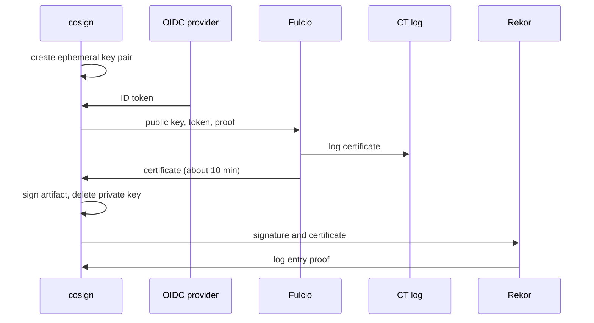

# From Long-Lived Keys To Short-Lived Certificates

A signature proves that the holder of a private key approved an artifact. That proof is only as good as the key. This part explains why long-lived keys are hard to keep safe, what keyless signing does instead, and which Sigstore service takes each step. By the end you will have seen every service of the flow running in your playground.

## The trouble with a long-lived key

With classic signing, you create a key pair once and keep the private key for as long as you sign. The public key goes to everyone who verifies. Three problems follow from that design, and each one gets worse the longer the key lives.

The first problem is storage. The private key must be somewhere the signer can reach it: a file, a CI secret, a hardware module. Every place it is stored is a place it can leak from. The second problem is meaning. A public key says nothing about who holds the private key; verifiers must learn that from somewhere else. The third problem is revocation. If the key leaks, every signature it ever made is in doubt, and every verifier must replace the public key it trusts.

Keyless signing removes the long-lived key instead of protecting it better. It uses three ideas, and the rest of this part takes them one at a time:

- an **ephemeral key**, created for one signature and thrown away;
- an **identity**, proven by an OpenID Connect (OIDC) token from a provider the verifier already trusts;
- a **public record**, so a signature can be checked long after the short-lived certificate has expired.

## The keyless flow, step by step

OpenID Connect (OIDC) is a protocol that lets an identity provider issue a signed **ID token**: a JSON Web Token (JWT) that says who a user or a workload is. Fulcio, the Sigstore certificate authority, accepts an ID token and a public key, and returns a certificate that binds the two. The diagram shows the order of events when cosign signs keylessly.



The diagram shows that the private key never leaves cosign and is deleted after one signature, while the certificate and the signature end up in two public logs.

Each service in the diagram does one job. The **OIDC provider** vouches for the identity; in your playground it is the Kubernetes API server, which issues service account tokens. **Fulcio** checks the token and issues a certificate valid for about ten minutes. The **certificate transparency (CT) log** records every certificate Fulcio issues, so a wrongly issued certificate cannot stay hidden. **Rekor**, the Sigstore transparency log, records the signature itself, with the time it was made.

## The services in your playground

The public-good Sigstore instance runs these services on the internet for anyone to use. Your playground runs a private copy of the same services inside the cluster, so you can sign without a browser and without sending anything outside. Look at them now.

<!-- astrona:playground:renew -->

List the deployments in the four Sigstore namespaces:

```sh
kubectl get deployments -n fulcio-system
kubectl get deployments -n rekor-system
kubectl get deployments -n ctlog-system
kubectl get deployments -n trillian-system
```

You see `fulcio-server` in `fulcio-system`, `rekor-server` and a Redis cache in `rekor-system`, `ctlog` in `ctlog-system`, and the Trillian log server, log signer and MySQL database in `trillian-system`. Trillian is the Merkle tree storage that both Rekor and the CT log are built on. Every deployment should show all its replicas ready.

A signer needs to know where these services are. cosign reads that from the signing configuration file. Print the services it lists:

```sh
kubectl -n workstation exec deploy/workstation -- \
  jq '{ca: [.caUrls[].url], tlog: [.rekorTlogUrls[].url]}' /etc/sigstore/signing-config.json
```

The output names `http://fulcio-server.fulcio-system.svc` as the certificate authority and `http://rekor-server.rekor-system.svc` as the transparency log. The public-good instance publishes the same kind of file for its own services. If the field names differ on your system, print the whole file with `jq .` and look for the two URLs.

## What the verifier trusts

Signing is half of the story; somebody must check the signature later. The verifier does not trust a public key from the signer. It trusts the certificate authority and the logs, and it reads their keys from the **trusted root** file.

```sh
kubectl -n workstation exec deploy/workstation -- \
  jq '{fulcio: [.certificateAuthorities[].uri], rekor: [.tlogs[].baseUrl], ctlog: [.ctlogs[].baseUrl]}' \
  /etc/sigstore/trusted-root.json
```

The output names the same three services, now with their certificates and public keys stored next to the URLs in the file. The public-good instance distributes its trusted root through The Update Framework (TUF), a system for publishing signed metadata that clients can update safely. Your private stack has no TUF server, so the environment built this file once and stored it in the ConfigMap `sigstore-trust`.

You now know what problem keyless signing solves and which service does each step: the OIDC provider vouches for the identity, Fulcio binds it to an ephemeral key, and two logs record the certificate and the signature. The open question is the identity itself: what exactly does the token say, and how does Fulcio know it is genuine?

## Common pitfalls

> [!WARNING]
> - **Thinking "keyless" means "no keys".** There is a key pair for every signature. It just lives for seconds, and the certificate, not the key, carries the identity.
> - **Mixing up the two logs.** The CT log records certificates Fulcio issued. Rekor records signatures. A complete keyless signature has an entry in both.
> - **Trusting the signer's public key.** A keyless verifier trusts Fulcio and the logs through the trusted root, never a key the signer sends along.
> - **Using the public-good trust root with a private stack.** cosign trusts the public-good instance by default. A private stack needs its own trusted root, passed with `--trusted-root`.
