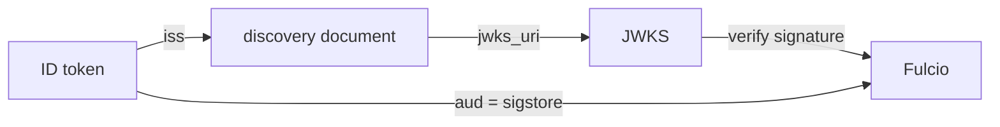

# Reading An OIDC Identity Token

Fulcio never meets the signer. Everything it knows about who is signing comes from one ID token, so the token decides what identity ends up in the certificate. This part opens the token your workstation uses, reads its claims one by one, and shows where Fulcio gets the keys to check it.

## A token the platform hands you

Your workstation never logged in anywhere, yet it holds a token. Kubernetes wrote it into the pod because the pod spec asks for a **projected service account token**: a token for the pod's service account, written into a file, with an audience and an expiry the pod spec chooses. The relevant part of the workstation's pod spec is this volume:

```yaml
- name: sigstore-token
  projected:
    sources:
      - serviceAccountToken:
          path: token
          audience: sigstore
          expirationSeconds: 3600
```

The kubelet, the Kubernetes agent on the node, asks the API server for the token and renews the file before it expires. A token that the platform hands a workload like this, with no stored secret, is called an **ambient credential**. GitHub Actions does the same for a workflow job, and that is why keyless signing works in CI without any secret.

## The three parts of a JWT

An ID token is a JSON Web Token (JWT): three Base64URL-encoded parts, a header, a payload and a signature, joined by dots. Base64URL is Base64 with `-` and `_` instead of `+` and `/`, and without padding. Open a shell in the workstation so the next commands run there:

<!-- astrona:playground:renew -->

```sh
kubectl -n workstation exec -it deploy/workstation -- sh
```

Count the parts of the token first:

```sh
tr '.' '\n' < /var/run/sigstore/token | wc -l
```

The answer is `3`. The first part is the header, the second the payload with the claims, the third the signature over the first two. Decode the payload with `jq`, which can read Base64 after the URL characters are swapped back and the padding is added:

```sh
cut -d. -f2 /var/run/sigstore/token | tr '_-' '/+' \
  | awk '{ while (length($0) % 4) $0 = $0 "="; print }' | base64 -d | jq .
```

The output is a JSON object with the claims of the token. The next section reads the ones Fulcio cares about.

## The claims that matter

A **claim** is one field in the token's payload. Fulcio reads a handful of them, and each answers one question:

| Claim | Question it answers | Value in your workstation token |
| --- | --- | --- |
| `iss` | Who issued the token? | The cluster's service account issuer, the same URL as in `/etc/sigstore/oidc-issuer` |
| `sub` | Who is it about? | `system:serviceaccount:workstation:workstation` |
| `aud` | Which service is it for? | `sigstore` |
| `exp` | Until when is it valid? | A Unix time about one hour after the token was issued |
| `kubernetes.io` | Which namespace, pod and service account? | An object with `namespace`, `pod` and `serviceaccount` |

Print just these claims to check them against the table:

```sh
cut -d. -f2 /var/run/sigstore/token | tr '_-' '/+' \
  | awk '{ while (length($0) % 4) $0 = $0 "="; print }' | base64 -d \
  | jq '{iss, sub, aud, exp, ns: ."kubernetes.io".namespace, sa: ."kubernetes.io".serviceaccount.name}'
cat /etc/sigstore/oidc-issuer; echo
```

The `iss` claim and the content of `oidc-issuer` are the same URL. On `kind` it is usually `https://kubernetes.default.svc.cluster.local`. The audience is exactly `sigstore`, and that matters: Fulcio refuses a token whose `aud` is not the client ID it is configured with, which here is `sigstore`. A token for any other audience, even a valid one, gets no certificate.

## How Fulcio checks the token

A claim is only worth something if the token is genuine. Fulcio checks the signature of the token with the issuer's public keys, and it finds those keys the standard OIDC way. Leave the workstation shell with `exit`, then ask the API server for its discovery document from your machine:

```sh
kubectl get --raw /.well-known/openid-configuration | jq '{issuer, jwks_uri}'
```

The **discovery document** names the issuer and the `jwks_uri`, the address of the JSON Web Key Set (JWKS): the public keys that sign every service account token. Fetch the keys too:

```sh
kubectl get --raw /openid/v1/jwks | jq '.keys[] | {kid, kty, alg}'
```

Fulcio fetches both documents itself, without a token of its own. That works because the environment binds the role `system:service-account-issuer-discovery` to unauthenticated clients. The two documents contain only public keys, so this is safe, but it is a setting a cluster administrator chooses on purpose.



The diagram shows Fulcio following the `iss` claim to the discovery document and the keys, and checking the audience before it trusts anything in the token.

You can now read an identity token claim by claim and say which issuer signed it, which workload it describes and which service it is meant for. The open question is what Fulcio does with these claims: which of them end up in the certificate, and in which field?

## Common pitfalls

> [!WARNING]
> - **Decoding with plain `base64 -d`.** JWT parts use Base64URL without padding. Swap `-_` for `+/` and pad to a multiple of four first, or the decoder fails or prints garbage.
> - **A token for the wrong audience.** A Kubernetes token for the API server has a different `aud`. Fulcio needs a token requested with the audience it is configured for, here `sigstore`.
> - **Reading claims as proof.** Anyone can write a JSON payload. The claims count only after the signature is checked with the issuer's keys, which is Fulcio's job.
> - **Pasting a token somewhere.** A token is a credential until `exp`. Read it in the pod; never copy a token from a real system into a ticket or a chat.
