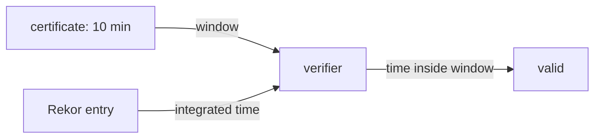

# What Fulcio Puts In A Certificate

The token proves who you are, but the token is not attached to the signature. The certificate is. This part signs a file keylessly, opens the certificate Fulcio issued, and finds the identity and the issuer in it. It then explains why a certificate that expired long ago still makes the signature verifiable.

## Signing a file keylessly

cosign signs a file, which it calls a blob, with `cosign sign-blob`. For a keyless signature it needs four inputs: the token, the signing configuration, the trusted root, and a file name for the **Sigstore bundle**, the one JSON document that holds the signature, the certificate and the log evidence. Open a shell in the workstation:

<!-- astrona:playground:renew -->

```sh
kubectl -n workstation exec -it deploy/workstation -- sh
```

Then sign the release file:

```sh
cosign sign-blob --yes \
  --identity-token /var/run/sigstore/token \
  --signing-config /etc/sigstore/signing-config.json \
  --trusted-root /etc/sigstore/trusted-root.json \
  --bundle /work/release/inventory-1.0.tar.gz.sigstore.json \
  /work/release/inventory-1.0.tar.gz
```

cosign reports that it got a certificate from Fulcio, uploaded an entry to the transparency log, and wrote the bundle. `--yes` skips the question cosign asks before it uploads to a public log. Nothing was saved on disk except the bundle: the private key is already gone.

## Inside the bundle

The bundle has three parts you will meet again and again. Print its outline:

```sh
jq '{mediaType, material: (.verificationMaterial | keys), tlogEntries: (.verificationMaterial.tlogEntries | length)}' \
  /work/release/inventory-1.0.tar.gz.sigstore.json
```

The `mediaType` names the bundle format version. `verificationMaterial` holds the certificate and the transparency log entries, and the bundle has one entry from Rekor. The third top-level part, `messageSignature`, holds the digest of the file and the signature over it.

## The certificate Fulcio issued

The certificate is stored as Base64 DER, the binary form of an X.509 certificate. Extract it and let `openssl` print it:

```sh
jq -r '.verificationMaterial.certificate.rawBytes' /work/release/inventory-1.0.tar.gz.sigstore.json \
  | base64 -d > /tmp/cert.der
openssl x509 -inform DER -in /tmp/cert.der -noout -dates -ext subjectAltName
```

Two things stand out. The `notBefore` and `notAfter` dates are about ten minutes apart. And the **Subject Alternative Name (SAN)**, the field that carries the identity, is the URI `https://kubernetes.io/namespaces/workstation/serviceaccounts/workstation`.

That URI is the format Fulcio uses for every Kubernetes token, built from the token's `kubernetes.io` claim: the namespace and the service account name. Fulcio does not put the pod name in the identity, so every pod that runs as the same service account signs as the same identity.

The issuer goes into a separate place. Fulcio writes it into a certificate extension with the object identifier (OID) `1.3.6.1.4.1.57264.1.8`, the "Issuer (V2)" extension, and an older copy into `1.3.6.1.4.1.57264.1.1`. Print the full certificate and look for the Sigstore OIDs:

```sh
openssl x509 -inform DER -in /tmp/cert.der -noout -text | grep -A1 '1.3.6.1.4.1.57264'
```

The value under the issuer extension is the same URL as `iss` in the token. A verifier needs both: the identity in the SAN and the issuer in the extension. An identity without its issuer means little, because any OIDC provider could issue a token with the same subject. The certificate also carries a signed certificate timestamp (SCT), the receipt from the certificate transparency log that the certificate was logged.

## Why an expired certificate still works

The certificate expired a few minutes after you signed. Yet the signature must stay verifiable for years. The transparency log entry solves this. Rekor recorded the signature together with an **integrated time**: the moment Rekor added the entry, signed by Rekor itself. Print it:

```sh
jq -r '.verificationMaterial.tlogEntries[0] | "logIndex=\(.logIndex) integratedTime=\(.integratedTime)"' \
  /work/release/inventory-1.0.tar.gz.sigstore.json
```

A verifier checks that this time lies inside the certificate's ten-minute window. If it does, the key was valid when it was used, and since the private key was deleted right afterwards, nobody can use it again. That is why a keyless verifier must never skip the log: without the log entry, there is no trusted time, and an expired certificate proves nothing.



The diagram shows the verifier comparing Rekor's signed time with the certificate's validity window instead of with the current time.

## Verifying the file

Now verify the file the way a consumer would. A keyless verification needs the expected identity and issuer; without them, cosign refuses to verify at all:

```sh
cosign verify-blob \
  --bundle /work/release/inventory-1.0.tar.gz.sigstore.json \
  --trusted-root /etc/sigstore/trusted-root.json \
  --certificate-identity https://kubernetes.io/namespaces/workstation/serviceaccounts/workstation \
  --certificate-oidc-issuer "$(cat /etc/sigstore/oidc-issuer)" \
  /work/release/inventory-1.0.tar.gz
```

cosign reports that the verification succeeded. It checked the certificate chain against Fulcio's root in the trusted root, the SCT against the CT log key, the log entry against Rekor's key, the integrated time against the certificate's window, the identity and the issuer, and finally the signature over the file. Change one letter of the identity and run it again: verification fails, because the identity no longer matches.

You now know what Fulcio writes into a certificate and how a verifier uses it: the identity in the SAN, the issuer in an extension, and the log's time to bridge the short validity. The open question is distribution: a bundle in a pod helps nobody, so how does the verifier get it?

## Common pitfalls

> [!WARNING]
> - **Verifying without an identity.** cosign refuses keyless verification without `--certificate-identity` (or its regexp form) and `--certificate-oidc-issuer`. Never work around this with a pattern that accepts everything.
> - **Skipping the log with `--insecure-ignore-tlog`.** Without the log entry there is no trusted signing time, so an expired certificate proves nothing.
> - **Expecting the pod name in the identity.** Fulcio writes the namespace and service account only. Give each signer its own service account if you need to tell them apart.
> - **Losing the bundle.** The bundle holds everything a verifier needs. Store and publish it next to the file it belongs to.

## Your mission: Sign A Release File Keylessly And Publish Its Bundle

You can now sign a file keylessly, read the identity in its certificate and verify it with the exact identity and issuer. The graded lab asks you to sign a release file as the workstation and publish its bundle in a ConfigMap, where any consumer in the cluster can fetch it.

The lab runs in its own cluster, so first pause your playground. Nothing in it is lost:

```sh
astrona stop ats-120-playground-010-01
```

Then start the lab:

```sh
astrona run --git ssh://git@github.com/astrona-io/ATS120.git -c sections/section-010/module-01/labs/lab-01
```

The task is on the next page. Solve it on your own first. When you think you are done, send it for grading:

```sh
astrona submit -c sections/section-010/module-01/labs/lab-01
```

When the lab is done, remove it and start your playground again:

```sh
astrona destroy ats-120-lab-010-01
astrona start ats-120-playground-010-01
```
