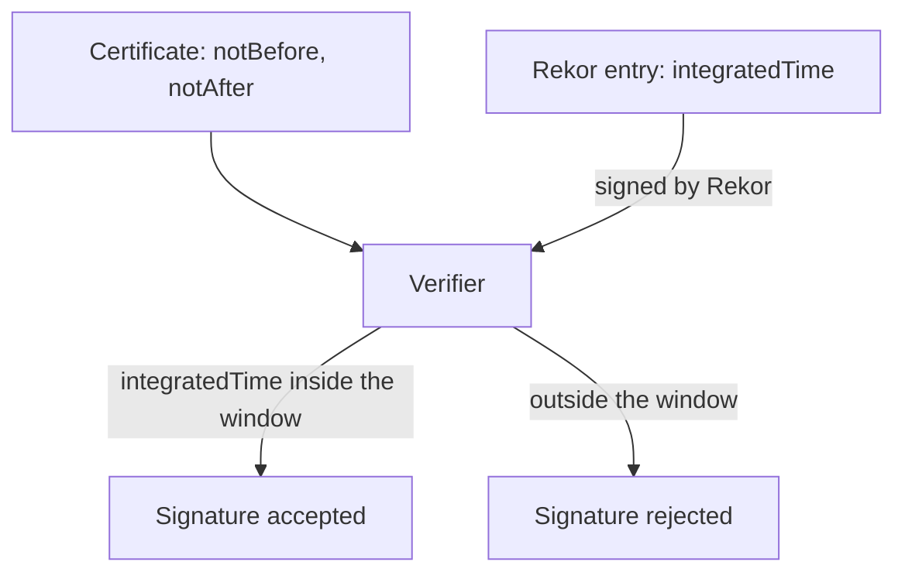

# Why The Signature Outlives The Certificate

A Fulcio certificate is valid for about ten minutes. A release image may be pulled for years. If a verifier simply checked the certificate dates at the time of verification, every keyless signature would fail ten minutes after it was made. This part explains the rule that makes old signatures verifiable, and which records carry the proof.

## The question a verifier really asks

A verifier does not ask "is the certificate valid now?". It asks "was the certificate valid at the moment the signature was made?". Those are different questions, and only the second one makes sense for a certificate that lives for minutes.

To answer the second question, the verifier needs a trusted statement about the time of signing. The signer cannot provide that time itself, because the signer controls its own clock. Sigstore therefore uses a third party: the transparency log. Rekor adds the signature to its log and records the time at which it did so. This value is the **integrated time**.

<!-- astrona:playground:renew -->

Look at the time values in a bundle. Open a shell in the workstation, sign the release file and print the log entry fields of its bundle (the signing helpers from the playground guide, `sign_file`, create `inventory-1.0.tar.gz.sigstore.json`):

```sh
kubectl -n workstation exec -it deploy/workstation -- sh
```

Then, inside the shell, sign the release file and print the log entry:

```sh
cosign sign-blob --yes --identity-token /var/run/sigstore/token \
  --signing-config /etc/sigstore/signing-config.json \
  --trusted-root /etc/sigstore/trusted-root.json \
  --bundle /work/release/inventory-1.0.tar.gz.sigstore.json /work/release/inventory-1.0.tar.gz
jq '.verificationMaterial.tlogEntries[0] | {logIndex, integratedTime, inclusionPromise: (.inclusionPromise | keys)}' \
  /work/release/inventory-1.0.tar.gz.sigstore.json
```

The output has the `logIndex`, the `integratedTime` as seconds since 1 January 1970 (Unix time) and the keys of the inclusion promise. Convert the time to a date with `date -d @<integratedTime>` if your `date` accepts that form, or with `jq 'todate'` on the number.

## The rule the verifier applies

The verifier takes the integrated time from the log entry and compares it with the certificate. The signature is accepted only if the integrated time is between the certificate's `notBefore` and `notAfter`. The log entry is trusted because the log signs it: the bundle holds a **signed entry timestamp** (an inclusion promise) made with the Rekor key, and often an inclusion proof against a signed log checkpoint. Both are checked against the Rekor key in the trusted root.



The diagram shows that two independent records meet at the verifier: the certificate says how long the identity was valid, and the log says when the signature happened.

Check the window yourself. Print the certificate dates from the bundle, inside the same shell:

```sh
jq -r '.verificationMaterial.certificate.rawBytes // .verificationMaterial.x509CertificateChain.certificates[0].rawBytes' \
  /work/release/inventory-1.0.tar.gz.sigstore.json \
  | base64 -d | openssl x509 -inform DER -noout -dates
```

The two dates are about ten minutes apart, and the integrated time you printed earlier falls between them. You can verify the bundle hours later and it still passes, because the dates are compared with the integrated time and not with the clock of the machine.

## What the log does not do

The log does not decide whether the signer was allowed to sign. It records that a signature by this certificate existed at that time. The decision about who may sign stays with the verifier, through the exact identity and issuer it demands. The log also cannot hide a signature: anyone can ask Rekor for all entries that match a certificate identity or an artifact hash, so a signature made with a stolen identity can be found.

A bundle without a log entry has no trusted time, so a verifier that follows the rules above cannot accept it. You now know why the log entry is part of every keyless bundle.

## Common pitfalls

> [!WARNING]
> - **Comparing the certificate with the current time.** A correct verifier compares it with the integrated time. Do not try to make a script check `notAfter` against the clock.
> - **Skipping the log with an insecure flag to make an old signature pass.** If an old signature fails, find the real cause. The flag removes the proof of when the signature happened.
> - **Trusting the signer's clock.** Only the time in the log entry, signed by Rekor, counts.
