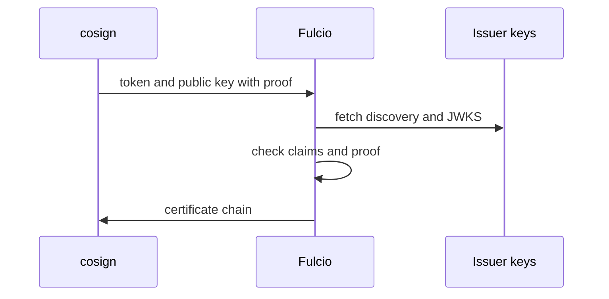

# The Request Fulcio Receives

Every keyless signature starts with one request to Fulcio. If you know what is in that request, you know what Fulcio can and cannot promise. This part shows the request, the two proofs it carries, and the checks Fulcio makes before it signs a certificate.

## What cosign sends

Fulcio is a service with an HTTP and gRPC interface. To get a certificate, cosign calls `CreateSigningCertificate`, served over HTTP as `POST /api/v2/signingCert`. The request carries two things. The first is the OIDC identity token. The second is the ephemeral public key, in one of two forms: a PKCS #10 certificate signing request (CSR), which is signed by the ephemeral private key, or a plain public key with a separate proof of possession. A **proof of possession** is a signature, made with the ephemeral private key, over a value Fulcio can check. For the plain form, the signed value is the `sub` claim of the token (or the email address for email tokens). The proof shows that the caller holds the private key that matches the public key.

<!-- astrona:playground:renew -->

You can see which Fulcio endpoints exist without sending any token. Open a shell in the workstation:

```sh
kubectl -n workstation exec -it deploy/workstation -- sh
```

Ask Fulcio for its configuration and for its trust bundle:

```sh
curl -s http://fulcio-server.fulcio-system.svc/api/v2/configuration | jq .
curl -s http://fulcio-server.fulcio-system.svc/api/v2/trustBundle | jq 'keys'
```

The configuration lists the OIDC issuers Fulcio accepts, with the audience each one needs. The trust bundle holds the certificate chains Fulcio signs with. Neither call needs a token, because both only publish public information.

## What Fulcio checks

Fulcio does the following checks, in this order, and refuses the request at the first one that fails:

1. The token is a well-formed JWT and its `iss` claim names an issuer in Fulcio's configuration.
2. The token signature is valid for that issuer's keys, which Fulcio fetches from the issuer's discovery document and JWKS (JSON Web Key Set).
3. The token has not expired and its audience matches the one configured for the issuer (`sigstore` here).
4. Fulcio can build an identity from the claims for that issuer type, for example the service account URI for a Kubernetes token.
5. The proof of possession is valid for the public key.



The diagram shows that Fulcio itself calls the issuer to fetch its public keys; cosign does not send them.

## What the request does not prove

Fulcio never sees the signed artifact. It does not know what you are signing, and it does not decide whether you may sign it. The certificate says only that the holder of this ephemeral key held a valid token for this identity at this moment. Everything else is for the verifier to decide, using the identity and the issuer.

You can see a refused request with a token that has the wrong audience. Create one by asking cosign to use a file that is not a token:

```sh
echo not-a-token > /tmp/bad-token
cosign sign-blob --yes --identity-token /tmp/bad-token \
  --signing-config /etc/sigstore/signing-config.json \
  --trusted-root /etc/sigstore/trusted-root.json \
  /work/release/inventory-1.0.tar.gz
```

The command fails. The error comes from the certificate step, and no Rekor entry is created. Run it again with `--identity-token /var/run/sigstore/token` and it succeeds.

You now know what is in the request and what Fulcio checks. The open question is what Fulcio answers with, and how a verifier decides to trust it.

## Common pitfalls

> [!WARNING]
> - **Thinking the proof of possession proves the artifact.** It only proves that the caller holds the ephemeral private key.
> - **Reading a Fulcio refusal as a network error.** A refused token is an answer from Fulcio. Check the token claims and the issuer list first.
> - **Expecting Fulcio to know the artifact.** Fulcio signs identity certificates only.
