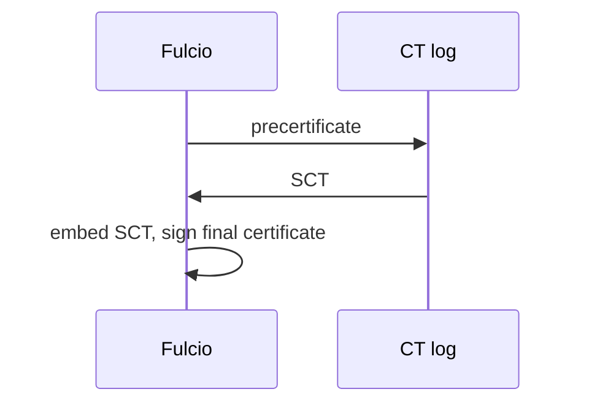

# Certificate Transparency And The SCT

A certificate authority that issues a certificate nobody can see is hard to audit. Certificate transparency (CT) solves this by writing every certificate to a public log. This part shows how Fulcio uses a CT log and how the proof of that write sits inside each certificate.

## What the CT log adds

A **certificate transparency log** is an append-only log of certificates. Before Fulcio returns a certificate, it sends a **precertificate** (a copy of the certificate with a marker that stops it from being used) to the CT log. The log answers with a **signed certificate timestamp (SCT)**: a signature by the log over the precertificate and the time of the entry. Fulcio embeds the SCT in the final certificate as an extension. A verifier that sees a certificate without a valid SCT can refuse it, because Fulcio did not log it.



The diagram shows that the SCT exists before the final certificate is signed, so the certificate carries its own proof of logging.

<!-- astrona:playground:renew -->

Find the SCT in a real certificate. In the workstation shell, sign the release file and extract the leaf certificate as before:

```sh
kubectl -n workstation exec -it deploy/workstation -- sh
```

```sh
cosign sign-blob --yes --identity-token /var/run/sigstore/token \
  --signing-config /etc/sigstore/signing-config.json \
  --trusted-root /etc/sigstore/trusted-root.json \
  --bundle /tmp/release.sigstore.json /work/release/inventory-1.0.tar.gz
jq -r '.verificationMaterial.certificate.rawBytes // .verificationMaterial.x509CertificateChain.certificates[0].rawBytes' \
  /tmp/release.sigstore.json | base64 -d | openssl x509 -inform DER -out /tmp/leaf.pem
openssl x509 -in /tmp/leaf.pem -noout -text | grep -A3 'CT Precertificate SCTs'
```

The output shows the extension `CT Precertificate SCTs` (object identifier `1.3.6.1.4.1.11129.2.4.2`) with the SCT version, the log ID and a timestamp.

## What the verifier does with the SCT

The verifier takes the SCT from the certificate, finds the log ID in the `ctlogs` list of its trusted root, and checks the log's signature with that log's public key. If the log is not in the trusted root, or the signature is wrong, the verification fails. This is the check that the flag `--insecure-ignore-sct` switches off, and the graders in this course reject it.

You can see the log your stack uses in the trusted root:

```sh
jq '.ctlogs[] | {baseUrl, logId: .logId.keyId}' /etc/sigstore/trusted-root.json
```

The output lists one CT log with its base URL and key ID. The same key ID appears in the SCT you printed above.

You now know what proof of logging a certificate carries and how a verifier checks it. The open question is the second log, Rekor, which records the signature itself.

## Common pitfalls

> [!WARNING]
> - **Confusing the two logs.** The CT log records certificates. Rekor records signatures. A bundle needs both proofs.
> - **Switching the SCT check off to fix an error.** The flag hides a trust root that does not list the CT log. Fix the trusted root instead.
> - **Expecting an SCT in every certificate.** A certificate from a Fulcio without a CT log has none. A verifier configured to require SCTs rejects it.
