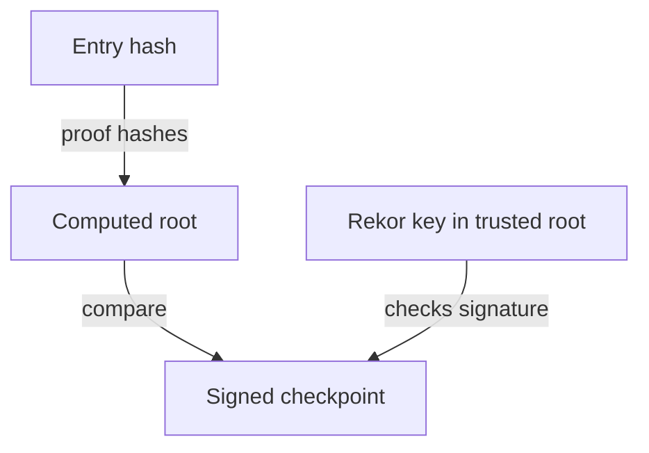

# Reading A Rekor Entry

Rekor is the log that makes a signature visible to everyone. The bundle holds a copy of the entry, but you can also ask Rekor for the entry directly and check that both agree. This part looks up entries by index and by hash and explains the two proofs inside them.

## What an entry holds

Rekor v1 stores entries of several types. cosign records a file or image signature as a `hashedrekord` entry: the hash of the artifact, the signature and the certificate. An attestation is recorded as a `dsse` entry. Each entry has a **log index** (its position in the log), an **integrated time**, the **log ID** and a **UUID**.

<!-- astrona:playground:renew -->

Look at the log itself first. In the workstation shell:

```sh
kubectl -n workstation exec -it deploy/workstation -- sh
```

```sh
rekor-cli loginfo --rekor_server http://rekor-server.rekor-system.svc
```

The output names the tree size (the number of entries) and the root hash of the Merkle tree. A **Merkle tree** is a hash tree in which the root hash changes whenever any entry changes, so the log cannot alter an old entry unnoticed.

## Finding an entry

Sign the release file, then find the entry in three ways. First take the log index from the bundle and ask Rekor for it:

```sh
cosign sign-blob --yes --identity-token /var/run/sigstore/token \
  --signing-config /etc/sigstore/signing-config.json \
  --trusted-root /etc/sigstore/trusted-root.json \
  --bundle /tmp/release.sigstore.json /work/release/inventory-1.0.tar.gz
INDEX="$(jq -r '.verificationMaterial.tlogEntries[0].logIndex' /tmp/release.sigstore.json)"
rekor-cli get --rekor_server http://rekor-server.rekor-system.svc --log-index "$INDEX"
```

The output shows the log index, the integrated time, the UUID and the entry body with the artifact hash, the certificate and the signature. Next search by the artifact hash:

```sh
rekor-cli search --rekor_server http://rekor-server.rekor-system.svc \
  --sha "sha256:$(sha256sum /work/release/inventory-1.0.tar.gz | cut -d' ' -f1)"
```

The output is a list of UUIDs, one per time this file was signed. Signing the same file twice gives two entries. This search is how anyone can find every signature ever made over a file.

## The two proofs

A bundle holds two proofs that the entry is in the log. The **signed entry timestamp (SET)** is a promise: Rekor signed the entry and its time. The **inclusion proof** is stronger: a list of hashes that connects the entry to the signed checkpoint (the tree size and root hash, signed by Rekor). The verifier recomputes the root from the entry and the hashes and compares it with the checkpoint. Both are checked against the Rekor key in the trusted root.



The diagram shows that the verifier needs no connection to Rekor: the entry, the hashes and the checkpoint are in the bundle.

You now know how to find an entry and what proves it is in the log. The graded lab asks you to use this skill on a published release.

## Common pitfalls

> [!WARNING]
> - **Looking up by the wrong value.** The `--sha` search needs the hash of the artifact, with the `sha256:` prefix, not the hash of the bundle.
> - **Assuming one entry per artifact.** Every signing run adds an entry. A search can return many.
> - **Treating the log index as stable across stacks.** Two Rekor servers number their entries separately.

## Your mission: Find The Rekor Entry Of A Release Signature

You can now read a bundle and look up its entry in Rekor. The graded lab gives you a published bundle and asks you to record its log index and signer identity in a ConfigMap, checked against the live log.

The lab runs in its own cluster, so first pause your playground. Nothing in it is lost:

```sh
astrona stop ats-120-playground-010-02
```

Then start the lab:

```sh
astrona run --git ssh://git@github.com/astrona-io/ATS120.git -c sections/section-010/module-02/labs/lab-01
```

The task is on the next page. Solve it on your own first. When you think you are done, send it for grading:

```sh
astrona submit -c sections/section-010/module-02/labs/lab-01
```

When the lab is done, remove it and start your playground again:

```sh
astrona destroy ats-120-lab-010-02
astrona start ats-120-playground-010-02
```
