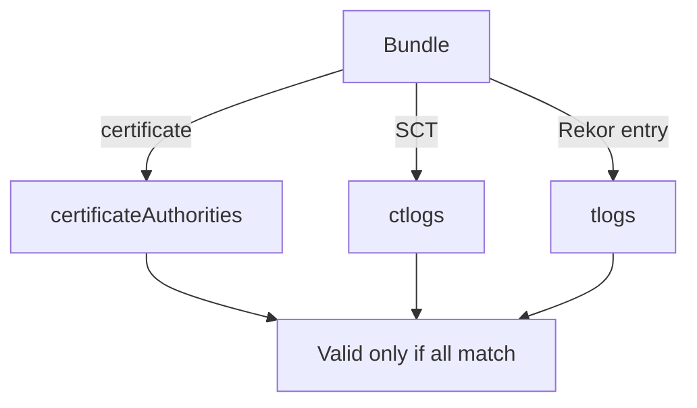

# What The Trusted Root Contains

When `cosign verify` or `verify-blob` says a signature is valid, it checks the signature against keys and certificates it already trusts. Those trusted items live in one file, the trusted root. This part opens the file and explains each list in it.

## The four lists

A **trusted root** (`trusted_root.json`) is a JSON file with a `mediaType` and four lists. Each list holds the trust anchors for one service of the Sigstore flow.

| List | Verifies | Holds |
| --- | --- | --- |
| `certificateAuthorities` | The Fulcio certificate chain | The Fulcio certificates (root and intermediates), a URI and a validity window |
| `tlogs` | Rekor entries: the signed entry timestamp and the checkpoint | The Rekor public key, the base URL, the hash algorithm and a validity window |
| `ctlogs` | The signed certificate timestamp (SCT) in the certificate | The CT log public key, the base URL and a validity window |
| `timestampAuthorities` | Signed timestamps from an RFC 3161 timestamp authority | The timestamp authority certificates; empty in the private stack |

<!-- astrona:playground:renew -->

Read the file in your playground. Open a shell in the workstation:

```sh
kubectl -n workstation exec -it deploy/workstation -- sh
```

Print the shape of the file, hiding the key bytes:

```sh
jq '{mediaType, tlogs: (.tlogs | length), certificateAuthorities: (.certificateAuthorities | length), ctlogs: (.ctlogs | length), timestampAuthorities: (.timestampAuthorities | length)}' \
  /etc/sigstore/trusted-root.json
```

The output shows a media type for a Sigstore trusted root and one entry in each of the first three lists. Now look inside one entry of each:

```sh
jq '.tlogs[0] | {baseUrl, hashAlgorithm, keyDetails: .publicKey.keyDetails, validFor: .publicKey.validFor}' /etc/sigstore/trusted-root.json
jq '.certificateAuthorities[0] | {uri, subject, validFor, certificates: (.certChain.certificates | length)}' /etc/sigstore/trusted-root.json
```

Each entry names the service URL it belongs to, the key type in `keyDetails` and a `validFor` range with a `start` time and, for retired keys, an `end` time.

## How the verifier uses the lists

The verifier takes each proof in the bundle and looks for the matching anchor. The certificate chain must reach a certificate in `certificateAuthorities` whose range covers the signing time. The SCT must verify with a key in `ctlogs`. The Rekor entry must verify with a key in `tlogs`. If one list has no matching entry, the verification fails, even if the other two are correct.



The diagram shows that each proof in the bundle needs its own anchor in the trusted root.

You now know what the verifier holds and why a missing list breaks verification. The open question is the matching file for signers.

## Common pitfalls

> [!WARNING]
> - **Mixing trusted roots between stacks.** A bundle signed in the private stack never verifies against the public-good root.
> - **Editing the file by hand.** Create it with `cosign trusted-root create` from the real certificates and keys.
> - **Fixing a failure by passing `--insecure-ignore-tlog`.** A missing `tlogs` entry is the cause. Repair the file.
