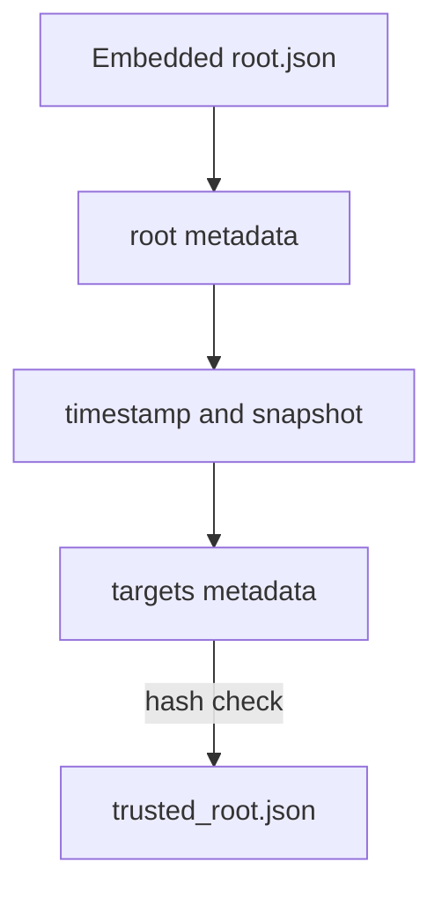

# How The Public-Good Instance Distributes Trust

On the public internet, a verifier cannot copy a file from a ConfigMap. It must fetch the trusted root over the network, and an attacker who changes that file could make a forged signature verify. This part explains how Sigstore delivers the file safely and how that differs from the private stack in your playground.

## The Update Framework

The Update Framework (TUF) is a specification for delivering files so that a client can detect tampering, replay of old files and a compromised mirror. Sigstore runs a TUF repository that publishes the trusted root and the signing configuration as **targets**. The repository is signed with a root of trust whose keys are held offline by several maintainers, and clients check each update against the keys they already hold.

A client starts from an initial root file that ships inside cosign. On first use, cosign downloads newer root, timestamp, snapshot and targets metadata from the TUF mirror, checks each one against the previous, and then downloads the `trusted_root.json` target and checks its hash. It caches the result in `~/.sigstore/root`.



The diagram shows that each file is checked by the one before it, back to the root that ships with cosign.

## What your playground does instead

The private stack has no TUF server. The bootstrap builds both files with cosign and passes them with `--trusted-root` and `--signing-config`. This is the same mechanism you would use for a private Sigstore deployment in a company: you either run your own TUF repository, or you distribute the files by another trusted route, such as a ConfigMap that only administrators can edit.

<!-- astrona:playground:renew -->

You can look at what a TUF-backed client would cache, if your machine has internet access. On your own workstation (not the pod), run:

```sh
cosign initialize
```

The command contacts the public TUF mirror and fills `~/.sigstore/root`. After it, `cosign verify` with no `--trusted-root` flag uses that cache. In the playground pod there is no such need, because the trust file is mounted. Check that the pod does not depend on a cache:

```sh
kubectl -n workstation exec deploy/workstation -- ls /etc/sigstore
```

The listing shows the files `trusted-root.json`, `signing-config.json` and `oidc-issuer` that the bootstrap mounted from the ConfigMap `sigstore-trust`.

## Who may change the file

For the private stack, the file is only as safe as the ConfigMap. Anyone who can edit `sigstore-trust` can make a verifier trust a different Fulcio. In a real deployment, limit write access to the file with RBAC, and review changes like changes to a certificate authority list.

You now know how trust reaches a verifier on the internet and in a private cluster. The graded lab asks you to repair a verifier whose trusted root is wrong.

## Common pitfalls

> [!WARNING]
> - **Passing `--trusted-root` for the public-good instance by habit.** Without the flag, cosign uses the TUF cache, which is the safe default there.
> - **Letting many people edit the trust ConfigMap.** It decides what every verifier accepts.
> - **Assuming the cache updates itself without internet.** An offline verifier keeps its last file.

## Your mission: Repair A Verifier's Trusted Root

You can now read a trusted root and find a range or a list that breaks verification. The graded lab gives you a verifier whose trust file no longer accepts a good release bundle, and asks you to repair it.

The lab runs in its own cluster, so first pause your playground. Nothing in it is lost:

```sh
astrona stop ats-120-playground-010-03
```

Then start the lab:

```sh
astrona run --git ssh://git@github.com/astrona-io/ATS120.git -c sections/section-010/module-03/labs/lab-01
```

The task is on the next page. Solve it on your own first. When you think you are done, send it for grading:

```sh
astrona submit -c sections/section-010/module-03/labs/lab-01
```

When the lab is done, remove it and start your playground again:

```sh
astrona destroy ats-120-lab-010-03
astrona start ats-120-playground-010-03
```
