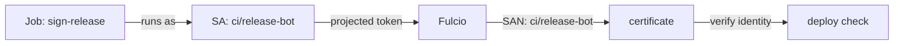

# Running The Signer As Its Own Workload

A signature from the workstation proves that someone with a shell in the workstation signed. For a release, that is the wrong statement: you want the signature to say that the release pipeline signed, and nothing else could have. This part moves the signing into a Kubernetes Job that runs as the service account `release-bot`, with no key and no Secret, and verifies that the signature names exactly that workload.

## One service account per signer

Fulcio writes the identity `https://kubernetes.io/namespaces/<namespace>/serviceaccounts/<name>` into every certificate it issues for a Kubernetes token. So the service account a pod runs as decides the identity of its signatures. Two consequences follow, and both shape the Job you are about to write.

First, a signer needs its own service account. If the release Job ran as `default`, every pod in the namespace that also runs as `default` could produce the same identity. Second, who may run pods as that service account now controls who may sign as it. In a real cluster, you limit that with role-based access control (RBAC) on the namespace, so only the pipeline can create pods there.

## The signing Job

The Job runs the official cosign image, `ghcr.io/sigstore/cosign/cosign:v3.1.4`. It gets three things from the pod spec: the service account, a projected token with the audience `sigstore`, and the trust files from the ConfigMap `sigstore-trust` in its own namespace. The image to sign comes from the ConfigMap `release-info` as an environment variable, so the Job always signs the recorded digest.

<!-- astrona:playground:renew -->

Save this as `job-sign-release.yaml`:

```yaml
apiVersion: batch/v1
kind: Job
metadata:
  name: sign-release
  namespace: ci
spec:
  backoffLimit: 0
  template:
    spec:
      serviceAccountName: release-bot
      restartPolicy: Never
      containers:
        - name: cosign
          image: ghcr.io/sigstore/cosign/cosign:v3.1.4
          args:
            - sign
            - --yes
            - --allow-http-registry
            - --identity-token=/var/run/sigstore/token
            - --signing-config=/etc/sigstore/signing-config.json
            - --trusted-root=/etc/sigstore/trusted-root.json
            - $(IMAGE)
          env:
            - name: IMAGE
              valueFrom:
                configMapKeyRef:
                  name: release-info
                  key: image
            - name: HOME
              value: /tmp
          volumeMounts:
            - name: sigstore-trust
              mountPath: /etc/sigstore
              readOnly: true
            - name: sigstore-token
              mountPath: /var/run/sigstore
              readOnly: true
            - name: tmp
              mountPath: /tmp
      volumes:
        - name: sigstore-trust
          configMap:
            name: sigstore-trust
        - name: sigstore-token
          projected:
            sources:
              - serviceAccountToken:
                  path: token
                  audience: sigstore
                  expirationSeconds: 600
        - name: tmp
          emptyDir: {}
```

Apply it:

```sh
kubectl apply -f job-sign-release.yaml
```

Then check the result:

```sh
kubectl -n ci wait --for=condition=complete job/sign-release --timeout=180s
kubectl -n ci logs job/sign-release
```

The Job completes, and its log shows cosign getting a certificate, uploading to the transparency log and pushing the signature. Three details in the Job matter. Kubernetes replaces `$(IMAGE)` in `args` with the environment variable's value, so cosign gets the digest from `release-info`. The cosign image has no shell and runs as a non-root user, so `HOME=/tmp` with an `emptyDir` gives it somewhere to write. And `expirationSeconds: 600`, the shortest the API server allows, keeps the token's lifetime close to the Job's.

## Verifying the release identity

Now check the signature the way a deployment step would: for the identity `ci/release-bot` only. Run it from the workstation:

```sh
kubectl -n workstation exec deploy/workstation -- sh -c '
  IMAGE="registry.localtest.me:5001/inventory/podinfo@$(regctl image digest registry.localtest.me:5001/inventory/podinfo:6.15.0)"
  cosign verify --allow-http-registry \
    --trusted-root /etc/sigstore/trusted-root.json \
    --certificate-identity https://kubernetes.io/namespaces/ci/serviceaccounts/release-bot \
    --certificate-oidc-issuer "$(cat /etc/sigstore/oidc-issuer)" \
    "$IMAGE" >/dev/null && echo "signed by ci/release-bot"'
```

It prints `signed by ci/release-bot`. If you signed the image from the workstation earlier, that signature is still attached too, and verifying for the workstation identity still passes. Each verification looks only for a signature from the identity it was given; a verifier that names `ci/release-bot` ignores every other signature on the image.



The diagram shows the chain that makes the signature meaningful: the Job's service account becomes the token's subject, then the certificate's identity, then the identity the deploy check demands.

You can now run a signer as its own workload, with no key and no Secret, and prove that its signatures name exactly that workload. The open question is what happens when a signing Job is set up slightly wrong: a wrong service account or a wrong audience fails in very different ways.

## Common pitfalls

> [!WARNING]
> - **Forgetting `serviceAccountName`.** The Job then runs as `default` and signs successfully, as the wrong identity. Always check the identity in the certificate, not just that the Job succeeded.
> - **A token with the wrong audience.** The projected token must have the audience Fulcio expects (`sigstore` here), or Fulcio refuses it and the Job fails.
> - **Editing a Job and re-applying it.** A Job's pod template cannot be changed after creation. Delete the Job and create it again.
> - **Mounting a signing key "just in case".** A keyless signer needs no Secret. Any key in the pipeline is a key that can leak.

## Your mission: Sign As The Release Bot

You can now write a signing Job that runs as its own service account and verify its identity. The graded lab gives you the release digest in the ConfigMap `release-info` and asks you to sign it as `ci/release-bot`, without any stored key.

The lab runs in its own cluster, so first pause your playground. Nothing in it is lost:

```sh
astrona stop ats-120-playground-020-01
```

Then start the lab:

```sh
astrona run --git ssh://git@github.com/astrona-io/ATS120.git -c sections/section-020/module-01/labs/lab-01
```

The task is on the next page. Solve it on your own first. When you think you are done, send it for grading:

```sh
astrona submit -c sections/section-020/module-01/labs/lab-01
```

When the lab is done, remove it and start your playground again:

```sh
astrona destroy ats-120-lab-020-01
astrona start ats-120-playground-020-01
```
