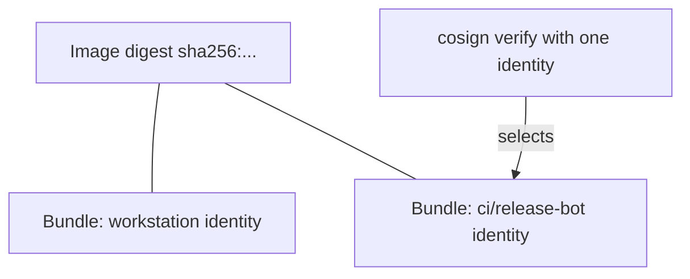

# Finding What Is Attached To An Image

A signature is not part of the image. Signing leaves the image manifest and its layers untouched and stores the signature as a separate object in the same registry. This part shows how to list what is attached to an image, how several signatures sit next to each other, and how to read the identity from the answer of `cosign verify`.

## Signing does not change the image

The digest of an image is the SHA-256 hash of its manifest. If signing changed the manifest, the digest would change, and the signature would no longer refer to the image it signed. So cosign v3 stores the signature as a Sigstore bundle in a separate artifact that points at the image digest. The artifact lives in the registry under the same repository.

<!-- astrona:playground:renew -->

Open a shell in the workstation and compare the digest before and after a signature:

```sh
kubectl -n workstation exec -it deploy/workstation -- sh
```

Then, inside the shell:

```sh
IMAGE=registry.localtest.me:5001/inventory/podinfo
regctl image digest $IMAGE:6.15.0
cosign sign --yes --allow-http-registry --identity-token /var/run/sigstore/token \
  --signing-config /etc/sigstore/signing-config.json --trusted-root /etc/sigstore/trusted-root.json \
  $IMAGE@$(regctl image digest $IMAGE:6.15.0)
regctl image digest $IMAGE:6.15.0
```

The two digests are the same. The tag still points at the same manifest, and the signature sits beside it.

## Listing what is attached

`cosign tree` lists the artifacts that refer to an image:

```sh
cosign tree --allow-http-registry $IMAGE@$(regctl image digest $IMAGE:6.15.0)
```

Each signature appears as one entry. Sign the same digest as a second identity (for example from a Job in the namespace `ci` as `release-bot`) and a second entry appears. The entries do not replace each other: a digest can carry any number of signatures from any number of identities.



The diagram shows one image with two attached signatures. A verifier that names `ci/release-bot` considers the second one and ignores the first.

## Reading the answer of cosign verify

A successful `cosign verify` prints a JSON array. Every element describes one signature that passed all the checks you gave. Print the digest it covers and the certificate fields:

```sh
cosign verify --allow-http-registry --trusted-root /etc/sigstore/trusted-root.json \
  --certificate-identity https://kubernetes.io/namespaces/workstation/serviceaccounts/workstation \
  --certificate-oidc-issuer "$(cat /etc/sigstore/oidc-issuer)" \
  $IMAGE@$(regctl image digest $IMAGE:6.15.0) \
  | jq '.[0] | {digest: .critical.image."docker-manifest-digest", optional: (.optional | keys)}'
```

The `docker-manifest-digest` is the digest the signature covers. The `optional` object holds the certificate details. List its keys first, then print the ones you need; the exact key names depend on the cosign version.

## Common pitfalls

> [!WARNING]
> - **Reading "signed" as "signed by the right party".** `cosign tree` shows that signatures exist, not whose they are. Only `cosign verify` with an identity and an issuer answers that.
> - **Verifying a tag and trusting the tag.** cosign resolves a tag to a digest at the time of the command. Always use the digest from `release-info` for a deployment decision.
> - **Expecting the old signature to disappear.** A second signature is added; the first stays until someone deletes it from the registry.
