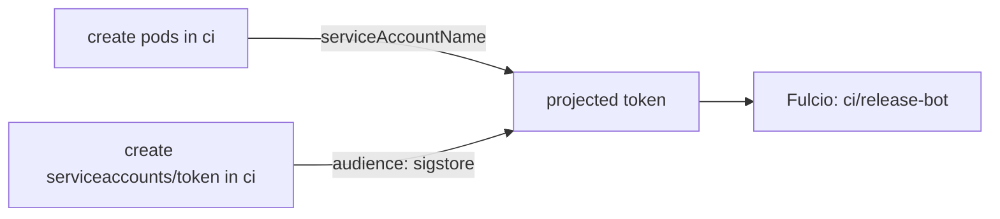

# Who Can Get A Token For A Service Account

Fulcio trusts a token because the cluster signed it. It does not ask how the token was obtained. So the question "who can sign as `ci/release-bot`?" is the question "who can get a token for `ci/release-bot` that carries the audience `sigstore`?" This part names the two ways to get one.

## Way one: run a pod as the service account

A pod that uses `serviceAccountName: release-bot` can have a projected token mounted, as the signing Job does. Anyone allowed to create a pod (or a Job, Deployment or CronJob that creates pods) in the namespace `ci` can set that field. The API server checks that the service account exists in the namespace; it does not check that the creator is the pipeline.

The permission is `create` on `pods` in the namespace, or on any workload resource that makes pods.

## Way two: ask the API server for a token

The API server has a subresource, `serviceaccounts/token`, that creates a token for a service account on request. The permission is `create` on `serviceaccounts/token`. `kubectl create token` uses it:

<!-- astrona:playground:renew -->

```sh
kubectl -n ci create token release-bot --audience sigstore --duration 10m
```

The command prints a JWT. Its subject is `system:serviceaccount:ci:release-bot` and its audience is `sigstore`. Hand that string to `cosign sign --identity-token` and Fulcio issues a certificate for `ci/release-bot`. No pod is needed.

Decode the payload of the token to see the claims:

```sh
kubectl -n ci create token release-bot --audience sigstore --duration 10m \
  | cut -d. -f2 | tr '_-' '/+' | base64 -d 2>/dev/null | jq '{iss, sub, aud, exp}'
```

Padding may be missing from the encoded part, which makes `base64 -d` print a warning at the end; the JSON before it is complete.



The diagram shows that two different permissions lead to the same token, and to the same signing identity.

## What does not give a token

Reading a service account or its metadata gives no token. Since Kubernetes 1.24, creating a service account no longer creates a long-lived token Secret by default, so listing Secrets does not leak a token for a service account created today. Old clusters can still hold such Secrets, and a long-lived token Secret has no audience binding to `sigstore` unless the cluster issuer allows it. Fulcio checks the issuer and audience of every token, so check what your stack accepts.

## Common pitfalls

> [!WARNING]
> - **Forgetting the token subresource.** Teams review who can create pods and forget `serviceaccounts/token`. Both permissions allow signing.
> - **Treating the token as a secret that is only in the pod.** A token minted with `kubectl create token` can be copied and used anywhere until it expires.
> - **Using long durations.** A signing token needs only minutes. Ask for the shortest `--duration` that works.
