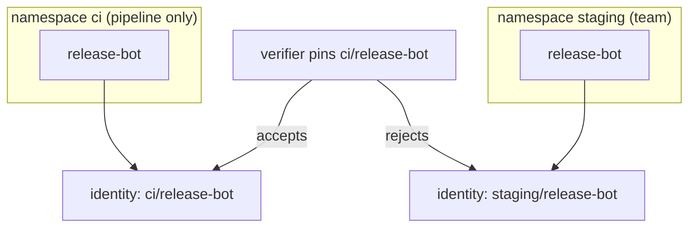

# Separate Signers By Namespace And Name

RBAC limits who can obtain a token. The identity in the certificate limits what a token is worth. This part shows how the namespace and the name in the identity give a verifier the means to reject signers it did not choose, even when many service accounts exist.

## The identity names the namespace

The identity is `https://kubernetes.io/namespaces/<namespace>/serviceaccounts/<name>`. Two service accounts with the same name in two namespaces have two different identities:

```
https://kubernetes.io/namespaces/ci/serviceaccounts/release-bot
https://kubernetes.io/namespaces/staging/serviceaccounts/release-bot
```

A verifier that pins the full string accepts the first and rejects the second. A verifier that uses a pattern such as `.*/serviceaccounts/release-bot` accepts both. Here the point is what it means for access. If a team owns the namespace `staging` and can create a `release-bot` there, a loose check accepts what the team signs.

<!-- astrona:playground:renew -->

Create the second service account in the playground and look at its token subject:

```sh
kubectl create namespace staging
kubectl -n staging create serviceaccount release-bot
kubectl -n staging create token release-bot --audience sigstore --duration 10m \
  | cut -d. -f2 | tr '_-' '/+' | base64 -d 2>/dev/null | jq -r .sub
```

The subject is `system:serviceaccount:staging:release-bot`. Fulcio turns it into the `staging` identity above.

## One signer, one namespace

A namespace is the natural border of access. These rules follow from it:

- Put a signing service account in a namespace that only the pipeline owns, such as `ci`.
- Do not reuse the name `release-bot` for other jobs. A name that means one thing is easier to pin.
- Give each kind of signature its own service account. A service account that signs release images should not sign test images, or a leak of the test pipeline lets a signature pass as a release.



The diagram shows two service accounts with one name and two identities, and a verifier that accepts only the one it pinned.

## The issuer is part of the story

The issuer in the certificate is the cluster's service account issuer. Two clusters have two issuers, so `ci/release-bot` in a test cluster and in the production cluster differ in the issuer extension even when the identity string is equal. A verifier that pins both the identity and the issuer cannot be satisfied by a signer in another cluster.

## Common pitfalls

> [!WARNING]
> - **Pinning only the name.** The name without the namespace matches signers you do not control.
> - **Sharing one service account between many jobs.** All their signatures look alike; a leak of any job leaks the identity.
> - **Forgetting the issuer.** Pin it. It is the only part that tells two clusters apart.
