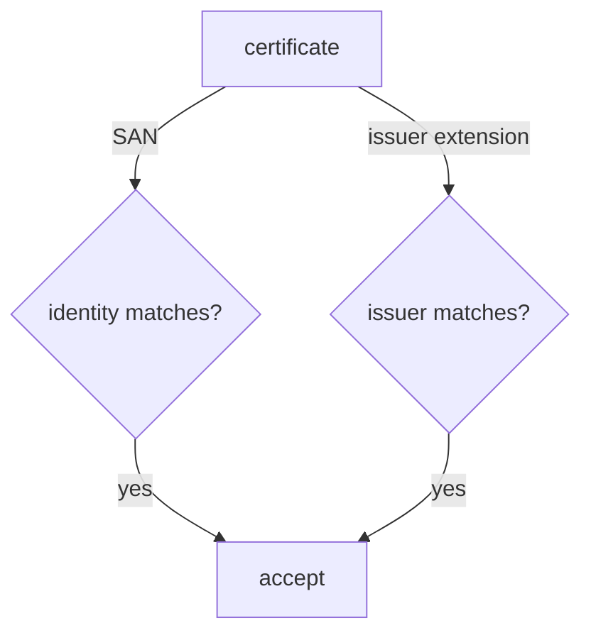

# Exact Identities, Regular Expressions And Issuers

Every keyless verification answers two questions: who signed, and who vouched for that identity. cosign lets you answer each one with an exact string or a regular expression. This part runs three checks against three signed images and shows how a check that looks strict can accept the wrong signer. It ends with a rule for writing identity checks that do what you mean.

## Three images, three signers

The three images in the registry are all validly signed, by three different service accounts. Two of them have the same service account name, `release-bot`, in different namespaces. Set up a small helper in a workstation shell so the checks are short to type:

<!-- astrona:playground:renew -->

```sh
kubectl -n workstation exec -it deploy/workstation -- sh
```

```sh
REG=registry.localtest.me:5001/inventory/podinfo
ISSUER="$(cat /etc/sigstore/oidc-issuer)"
check() {
  for tag in 6.15.0 6.15.0-rc1 6.15.0-hotfix; do
    if cosign verify --allow-http-registry --trusted-root /etc/sigstore/trusted-root.json \
         "$@" "$REG:$tag" >/dev/null 2>&1; then echo "$tag: accepted"; else echo "$tag: rejected"; fi
  done
}
```

The `check` function runs `cosign verify` with whatever identity flags you pass, on each of the three images, and prints whether it accepted the image.

## An exact identity

The strictest check names the full identity URI with `--certificate-identity`. cosign then accepts a certificate only if its Subject Alternative Name is exactly that string:

```sh
check --certificate-identity https://kubernetes.io/namespaces/ci/serviceaccounts/release-bot \
      --certificate-oidc-issuer "$ISSUER"
```

Only `6.15.0` is accepted. The other two are rejected, even though their signatures are valid, because their certificates name other identities. When you know the one signer you trust, an exact identity is the right choice: there is nothing to get wrong.

## A loose regular expression

Sometimes several signers are acceptable, so teams reach for `--certificate-identity-regexp`. It takes a Go regular expression (the RE2 syntax) and accepts any identity it matches. The danger is that a regular expression matches *anywhere* in the string unless you anchor it. Try the pattern a hurried team might write:

```sh
check --certificate-identity-regexp 'release-bot' \
      --certificate-oidc-issuer "$ISSUER"
```

Both `6.15.0` and `6.15.0-rc1` are accepted. The pattern `release-bot` is found inside both URIs, because it does not say which namespace. A pipeline in the namespace `build` can now ship images that pass your release check.

## An anchored regular expression

The fix is to anchor the pattern: `^` at the start, `$` at the end, and every literal dot escaped as `\.`, because an unescaped `.` matches any character. Write the whole URI that way:

```sh
check --certificate-identity-regexp '^https://kubernetes\.io/namespaces/ci/serviceaccounts/release-bot$' \
      --certificate-oidc-issuer "$ISSUER"
```

Only `6.15.0` is accepted again. An anchored regular expression is useful when a real choice exists, for example `^https://kubernetes\.io/namespaces/ci/serviceaccounts/(release-bot|hotfix-bot)$` to accept two named signers. If the pattern has no alternatives in it, use `--certificate-identity` instead and avoid the risk entirely.

## Pinning the issuer

The identity is only half of the check. The issuer says who vouched for it, and an identity from the wrong issuer is worthless. Imagine a second Kubernetes cluster whose Fulcio-trusted tokens also produce the URI `https://kubernetes.io/namespaces/ci/serviceaccounts/release-bot`: that URI is the same in every cluster, so only the issuer tells the clusters apart. Run the exact identity again with an issuer pattern that accepts anything:

```sh
check --certificate-identity https://kubernetes.io/namespaces/ci/serviceaccounts/release-bot \
      --certificate-oidc-issuer-regexp '.*'
```

In this playground the result looks the same, because there is only one issuer. That is exactly why the mistake survives review: the check passes every test you run, and it would also pass a signature from any other cluster or provider that Fulcio trusts. Always pin the issuer with `--certificate-oidc-issuer` and the exact URL, here the content of `/etc/sigstore/oidc-issuer`.



The diagram shows that the identity and the issuer are two separate checks on the certificate, and cosign accepts the signature only when both match.

You can now write an identity check that accepts exactly the signer you mean, and you know why the issuer must be pinned as tightly as the identity. The open question is the most common signer on the internet: GitHub Actions identities look different, and they carry far more than a name.

## Common pitfalls

> [!WARNING]
> - **An unanchored regular expression.** `release-bot` matches any URI containing it. Anchor with `^` and `$`.
> - **Unescaped dots.** In a regular expression `.` matches any character, so `kubernetes.io` also matches `kubernetesXio`. Write `kubernetes\.io`.
> - **`--certificate-oidc-issuer-regexp '.*'`.** It looks harmless when there is only one issuer in your tests. It accepts every issuer Fulcio trusts.
> - **A regular expression where an exact string would do.** If there is only one acceptable identity, `--certificate-identity` is simpler and cannot be too loose.
