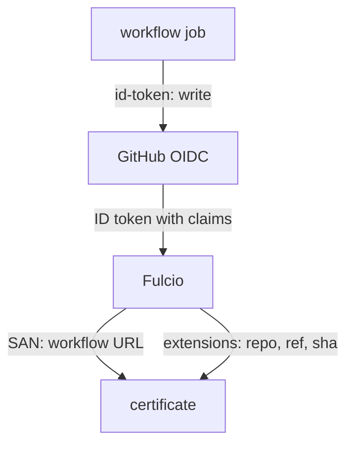

# GitHub Actions Identities

Most keyless signatures on public images come from GitHub Actions. A workflow job asks GitHub for an ID token, cosign exchanges it for a Fulcio certificate, and the image is signed with no key anywhere. Those certificates carry much more than a name: Fulcio records which repository, which workflow, which commit and which event produced the signature. This part reads that information and uses it to verify a real public image.

## What a GitHub Actions token says

GitHub's OpenID Connect (OIDC) provider has the issuer URL `https://token.actions.githubusercontent.com`. A workflow job that has the permission `id-token: write` can ask it for an ID token. The token's claims describe the run: the repository, the workflow file, the git reference, the commit, the event that triggered it, and more.

Fulcio turns those claims into the certificate. The identity in the Subject Alternative Name is the URL of the workflow file at the reference it ran from, in the form `https://github.com/<owner>/<repository>/.github/workflows/<file>@<ref>`.

When a repository calls a reusable workflow from another repository, the identity is the URL of the reusable workflow, not of the calling repository. That detail is why an identity alone is often not enough for GitHub Actions, and why Fulcio also records the claims separately.

## The claims Fulcio records

Fulcio writes each claim into its own certificate extension, under the object identifier (OID) prefix `1.3.6.1.4.1.57264.1`. The ones you check most often are these:

| OID | Name | Example meaning |
| --- | --- | --- |
| `.1.8` | Issuer (V2) | `https://token.actions.githubusercontent.com` |
| `.1.12` | Source Repository URI | The repository the run belongs to |
| `.1.14` | Source Repository Ref | The git reference, such as a tag |
| `.1.13` | Source Repository Digest | The commit the run built |
| `.1.20` | Build Trigger | The event, such as `push` |
| `.1.9` | Build Signer URI | The workflow file that ran, the same as the identity |

Older certificates also carry GitHub-specific extensions, `.1.2` to `.1.6` (trigger, SHA, workflow name, repository and reference). Fulcio documents them as deprecated in favour of the generic ones above, and cosign's `--certificate-github-workflow-*` flags check the values from those GitHub-specific fields.

## Verifying a public image

Flux, the GitOps tool, signs its controller images in GitHub Actions and documents how to verify them. Its documentation uses an organisation-wide pattern. Run it on the source-controller image from Flux v2.9.6, in a workstation shell. This verification uses cosign's built-in trust root for the public-good Sigstore instance, so there is no `--trusted-root`, and it needs outbound internet:

<!-- astrona:playground:renew -->

```sh
kubectl -n workstation exec -it deploy/workstation -- sh
```

```sh
cosign verify ghcr.io/fluxcd/source-controller:v1.9.6 \
  --certificate-identity-regexp='^https://github\.com/fluxcd/' \
  --certificate-oidc-issuer=https://token.actions.githubusercontent.com >/dev/null && echo accepted
```

It prints `accepted`. On the first run, cosign also downloads the public-good trust root through The Update Framework (TUF) and stores it in `~/.sigstore`. The pattern is anchored and the issuer is pinned, so it looks correct. Now run the same check on a different Flux image, the kustomize-controller:

```sh
cosign verify ghcr.io/fluxcd/kustomize-controller:v1.9.6 \
  --certificate-identity-regexp='^https://github\.com/fluxcd/' \
  --certificate-oidc-issuer=https://token.actions.githubusercontent.com >/dev/null && echo accepted
```

It is accepted too. The check proves "something in the `fluxcd` organisation signed this", which is exactly what Flux promises, but it cannot tell its images apart. If you want to accept only images built by one repository, add the repository claim:

```sh
for image in source-controller kustomize-controller; do
  cosign verify "ghcr.io/fluxcd/$image:v1.9.6" \
    --certificate-identity-regexp='^https://github\.com/fluxcd/' \
    --certificate-oidc-issuer=https://token.actions.githubusercontent.com \
    --certificate-github-workflow-repository=fluxcd/source-controller >/dev/null 2>&1 \
    && echo "$image: accepted" || echo "$image: rejected"
done
```

Now source-controller is accepted and kustomize-controller is rejected, because its certificate records the repository `fluxcd/kustomize-controller`. If you also want a specific release, `--certificate-github-workflow-ref` pins the git reference, for example `refs/tags/v1.9.6`.



The diagram shows Fulcio copying the GitHub run's claims into separate certificate extensions next to the identity, which is what lets a verifier check the repository and the reference independently.

You can now read what a GitHub Actions certificate records and verify a public image for one repository instead of a whole organisation. The open question is what you need when the verifier has no network: can a signature be checked with only the file and its bundle?

## Common pitfalls

> [!WARNING]
> - **Trusting an organisation-wide pattern for one image.** `^https://github\.com/<org>/` accepts every repository in the organisation. Add the repository claim when only one repository may ship the image.
> - **Forgetting reusable workflows.** The identity is the reusable workflow's URL. Check the source repository claim, not only the identity.
> - **An unpinned GitHub issuer.** Without `--certificate-oidc-issuer=https://token.actions.githubusercontent.com`, another OIDC provider's identity with the same URL text would pass.
> - **Mixing trust roots.** Public images verify against the public-good trust root (the default). Images from the private stack need `--trusted-root /etc/sigstore/trusted-root.json`.
