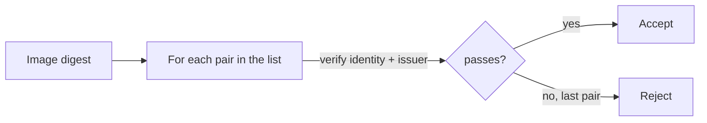

# Checking A List Of Allowed Signers

A real deployment rarely trusts exactly one signer. The release pipeline signs production images, a hotfix pipeline signs patches, and an older service account is still allowed during a migration. This part writes a check that accepts a short, explicit list of signers and nothing else, and shows the mistakes that turn such a list into an open door.

## A list is a list of pairs

Each allowed signer is a pair: an exact identity and the exact issuer that vouches for it. A list of identities alone is not enough, because the same identity string can come from a different issuer. Keep the pairs together in one place, for example in a file with one pair per line:

```
https://kubernetes.io/namespaces/ci/serviceaccounts/release-bot https://kubernetes.default.svc.cluster.local
https://kubernetes.io/namespaces/ci/serviceaccounts/hotfix-bot https://kubernetes.default.svc.cluster.local
```

The issuer in the second column must be the issuer of your cluster. Read it from the ConfigMap `sigstore-trust` key `oidc-issuer` in the playground instead of typing the value above.

## The check as a script

<!-- astrona:playground:renew -->

The script below takes an image reference and the file of pairs, and exits 0 only when at least one pair verifies. Save it in the workstation as `/tmp/verify-any.sh`:

```sh
#!/bin/sh
# verify-any.sh IMAGE PAIRS_FILE: exits 0 when IMAGE verifies for one listed pair.
IMAGE="$1"; PAIRS="$2"
while read -r IDENTITY ISSUER; do
  [ -n "$IDENTITY" ] || continue
  if cosign verify --allow-http-registry --trusted-root /etc/sigstore/trusted-root.json \
       --certificate-identity "$IDENTITY" --certificate-oidc-issuer "$ISSUER" "$IMAGE" >/dev/null 2>&1; then
    echo "accepted: $IDENTITY"
    exit 0
  fi
done < "$PAIRS"
echo "rejected: no listed signer signed $IMAGE" >&2
exit 1
```

The loop runs one full verification per pair. Every verification pins an exact identity and an exact issuer, so a signer outside the list cannot pass. An error from cosign, for example an unreachable registry, also counts as "not accepted", which is the safe direction for a gate.

## Where such lists go wrong

Three mistakes keep appearing:

- **Regular expressions in the file.** A line that holds a pattern turns the list into a pattern match, with all the problems of loose expressions. Keep exact strings.
- **A wildcard issuer.** A pair whose issuer is "any" accepts the same identity string from any provider that can produce it.
- **A list that only grows.** Entries for signers that no longer exist stay valid. Remove an entry when its pipeline is retired and review the file as often as you review the roles that can sign.



The diagram shows the decision: the first pair that verifies accepts the image, and an image that verifies for none is rejected.

## Common pitfalls

> [!WARNING]
> - **Exiting 0 on errors.** A script whose last command is an `echo` returns 0 even when every verification failed. End the script with an explicit `exit 1` for the reject path.
> - **Mixing up the columns.** Identity first, issuer second, always. A swapped pair verifies nothing and fails closed, but it hides a typo.
> - **Verifying a tag.** Pass the digest reference.
