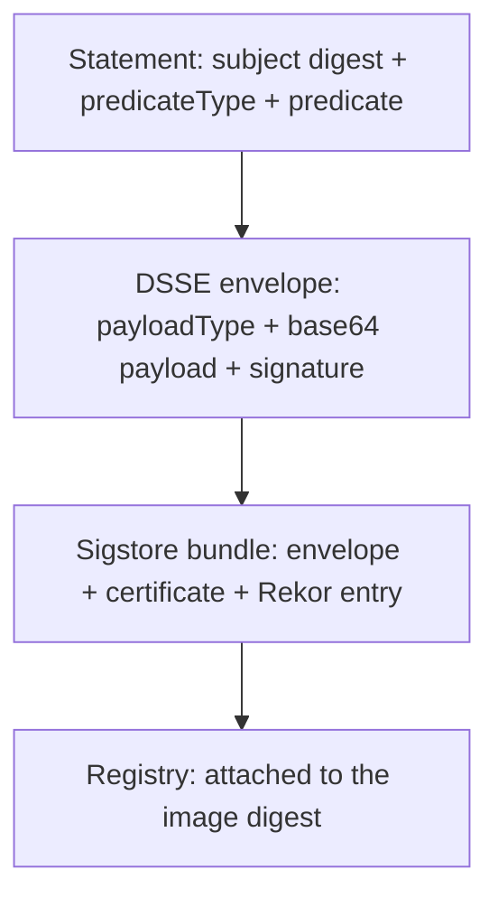

# What An Attestation Is

An attestation is a signed statement about an artifact. Two formats are involved: the **in-toto statement**, which holds the claim, and the **DSSE envelope**, which holds the signature over it. This part shows both, so that the output of the commands in the next parts is not a black box.

## The in-toto statement

A statement has three fields that matter here:

| Field | Content |
| --- | --- |
| `subject` | A list of artifacts, each with a name and a digest, for example the SHA-256 of an image |
| `predicateType` | A URI that names the kind of claim, which tells a reader how to interpret the predicate |
| `predicate` | The claim itself, as JSON |

The subject binds the claim to one exact digest. A statement about `sha256:abc...` says nothing about any other digest, so an attestation cannot be moved to another image: a verifier compares the subject with the digest it checks.

The predicate type decides the content. Well-known types exist for build provenance (SLSA), software bills of materials (SPDX and CycloneDX), vulnerability scans and VEX statements. You can also use your own URI for a claim of your own, which cosign calls a custom predicate.

## The DSSE envelope

The statement is not signed directly. It is wrapped in a Dead Simple Signing Envelope (DSSE) with three fields:

- `payloadType`, the media type of the payload, here `application/vnd.in-toto+json`.
- `payload`, the statement, base64 encoded.
- `signatures`, the signatures over the payload together with its type.

Signing the type together with the payload prevents a payload meant for one purpose from being reused in another. With keyless signing, the envelope's signature is made with the ephemeral key, and the Fulcio certificate and the Rekor entry travel in the Sigstore bundle, exactly as for a plain signature. In Rekor, an attestation is recorded as a `dsse` entry and a plain signature as a `hashedrekord` entry.

The diagram shows how a claim becomes an attached, verifiable object: statement, envelope, bundle, registry.

## Signature versus attestation

| | Signature | Attestation |
| --- | --- | --- |
| Question it answers | Who vouches for this digest? | Who vouches for this claim about this digest? |
| Content | None beyond the digest | A predicate you can read |
| Rekor entry kind | `hashedrekord` | `dsse` |
| Verified with | `cosign verify` | `cosign verify-attestation` |

Verifying the signer of an attestation uses the same flags as verifying a signature: the exact identity and the exact issuer. The extra step is reading the predicate and deciding whether the claim is acceptable.

## Common pitfalls

> [!WARNING]
> - **Trusting the predicate because the signature is valid.** A valid signature says who made the statement. It does not make the statement true. Decide which signers you trust for which predicate types.
> - **Ignoring the subject.** A verifier must check that the subject digest is the digest it is about to deploy. `cosign verify-attestation` does this when you give it a digest reference.
> - **Mixing predicate types.** A vulnerability scan and a provenance statement are different claims. Ask for the type you need with `--type`.
