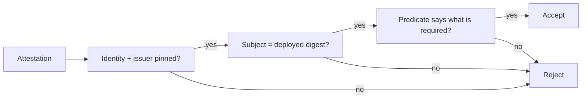

# Verifying An Attestation And Its Content

Two checks are needed: the attestation is signed by the identity and issuer you expect, and its predicate says what you require. This part does both with `cosign verify-attestation` and `jq`.

## Check the signer

`cosign verify-attestation` uses the same identity and issuer flags as `cosign verify`, plus `--type` to select the predicate type:

<!-- astrona:playground:renew -->

```sh
IMAGE=registry.localtest.me:5001/inventory/podinfo
cosign verify-attestation --allow-http-registry \
  --trusted-root /etc/sigstore/trusted-root.json \
  --type custom \
  --certificate-identity https://kubernetes.io/namespaces/workstation/serviceaccounts/workstation \
  --certificate-oidc-issuer "$(cat /etc/sigstore/oidc-issuer)" \
  $IMAGE@$(regctl image digest $IMAGE:6.15.0) > /tmp/verified.json
```

The command prints one JSON object per attestation that passed. An attestation from another identity, or of another type, does not appear. If none passes, the command fails.

## Read the predicate

Each object is an envelope. The statement is in `payload`, base64 encoded:

```sh
jq -r '.payload' /tmp/verified.json | base64 -d | jq '{predicateType, subject, predicate}'
```

The output shows the predicate type, the subject digest and the predicate. The subject digest equals the digest you verified.

## Check the content

A gate that requires "no critical findings" reads the number and decides:

```sh
jq -r '.payload' /tmp/verified.json | base64 -d | jq -e '.predicate | (if has("Data") then (.Data | if type == "string" then fromjson else . end) else . end) | .critical == 0'
```

`jq -e` sets the exit code from the result: 0 for true, 1 for false. A pipeline step that runs it stops when the claim is not acceptable. The filter reads the predicate directly, and handles a predicate that cosign wrapped in a `Data` field.

cosign can also evaluate a policy file with `--policy`, written in CUE or Rego, which keeps the rule in one reviewed file. The `jq` check is the same idea with fewer parts, and works the same in a short script.



The diagram shows three checks in order. A single failure rejects the attestation.

## Common pitfalls

> [!WARNING]
> - **Checking the content without pinning the signer.** Anyone can attest "critical: 0" about any digest. The identity decides whether the claim counts.
> - **Forgetting `--type`.** Without it, cosign verifies attestations of the default type and may find none.
> - **Reading only the first line.** One image can carry several attestations. Check them all or select by type and identity.
