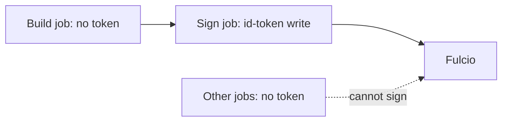

# Protecting The Signing Step

Keyless signing removes the key, but the signing step is still a place where a signature can be forged: any code that runs in the job with the right token can sign. This part lists what controls who can reach the token, in GitHub Actions and in Kubernetes.

## Grant the token only where it is needed

In GitHub Actions, a job gets an ID token only if it has the permission `id-token: write`. Set the permission on the signing job, not on the whole workflow, and keep everything else at the lowest level:

```yaml
permissions:
  contents: read

jobs:
  build:
    runs-on: ubuntu-latest
    steps:
      - run: echo "builds and tests run without an ID token"

  sign:
    needs: build
    runs-on: ubuntu-latest
    permissions:
      contents: read
      id-token: write
      packages: write
    steps:
      - run: echo "only this job can ask for an ID token"
```

A job without the permission cannot request an ID token, so a compromised test step cannot sign. The same logic applies to Kubernetes: the signing Job runs as its own service account, in a namespace where only the pipeline can create pods.

## Control what code runs in the signing job

The token is available to every step of the job, including steps from third-party actions. Reduce the exposure:

- Pin third-party actions to a full commit hash, not a tag. A tag can move to new code.
- Keep the signing job short: install cosign, sign the digest, stop. Do not build or test in the same job.
- Run the signing job only from the branches or tags that are allowed to release, and use a protected environment where your platform offers one.

The identity in the certificate then tells the verifier which workflow and which ref signed. A signing job restricted to the protected branch produces certificates whose ref is that branch, and a verifier can require it.

## Pull requests and forks

A workflow triggered by a pull request from a fork gets a reduced token without `id-token: write`, so it cannot sign. Do not work around this with triggers that give untrusted code the permissions of the base repository. A signature from a job that ran untrusted code is a signature of untrusted output.

## In Kubernetes

| Control | Effect |
| --- | --- |
| Dedicated service account for the signing Job | The identity names only that job |
| `expirationSeconds: 600` on the projected token | The token is short-lived |
| `automountServiceAccountToken: false` on all other pods in the namespace | Other pods do not carry a token |
| Namespace RBAC | Only the pipeline can create pods or tokens |



The diagram shows that the signing job is the only one allowed to reach Fulcio with a token.

## Common pitfalls

> [!WARNING]
> - **`id-token: write` at the top of the workflow.** Every job gets the permission. Put it on the signing job.
> - **Third-party actions pinned to a moving tag.** Pin a commit hash and review updates.
> - **Signing from a branch anyone can push to.** The branch is in the certificate; a verifier can only reject it if you decide on a branch.
