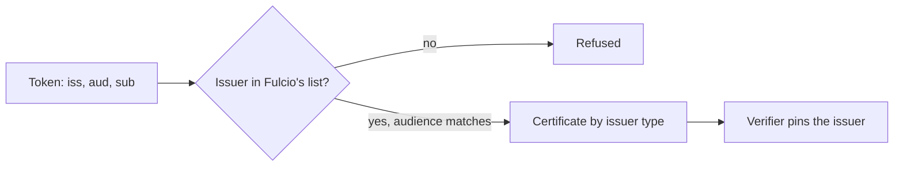

# How Fulcio Decides Which Issuers To Trust

An OIDC token is only as good as the party that issued it. Fulcio holds a list of issuers it trusts. A token from any other issuer is refused, however well formed. This part reads that list from the running Fulcio and explains the fields.

## The issuer entry

Each issuer in Fulcio's configuration has these fields:

| Field | Meaning |
| --- | --- |
| Issuer URL | The value of the `iss` claim. Fulcio fetches the provider's signing keys from here |
| Client ID | The audience Fulcio requires in the token's `aud` claim |
| Type | How to turn claims into an identity (email, github-workflow, kubernetes, and others) |
| Subject domain, or URL template | Used by some types to build the identity |

The type matters most. Fulcio v1.9.0 supports the types `email`, `username`, `uri`, `spiffe`, `kubernetes`, `github-workflow`, `gitlab-pipeline`, `codefresh-workflow`, `buildkite-job`, `chainguard-identity` and `ci-provider`. A type decides which claim becomes the subject alternative name and which claims become the extensions in the certificate. For a `github-workflow` issuer the subject is built from the workflow reference, and the repository and ref become extensions. For a `kubernetes` issuer the subject is built from the service account.

## Read the configuration of the private stack

<!-- astrona:playground:renew -->

Fulcio exposes its configuration over its API. Ask the workstation:

```sh
kubectl -n workstation exec deploy/workstation -- curl -s http://fulcio-server.fulcio-system.svc/api/v2/configuration
```

The answer is JSON that lists the issuers this Fulcio accepts. Pipe it to `jq .` to read it. Compare the issuer URL in it with the value in the ConfigMap `sigstore-trust`:

```sh
kubectl -n workstation get configmap sigstore-trust -o jsonpath='{.data.oidc-issuer}'
```

They are the same URL. This is the issuer a token must carry, and it is the value to pin with `--certificate-oidc-issuer`.

## Why a list, and why it matters for verification

The list is the first gate. A token from an unlisted issuer never becomes a certificate, so no signature exists for it. But the list does not make a verifier safe: if the list holds several issuers, a signature can come from any of them, and a check that does not pin the issuer accepts all of them.



The diagram shows that Fulcio's list decides which tokens become certificates, and the verifier's pin decides which certificates count.

## Public and private instances

The public-good Fulcio trusts a fixed set of well-known public providers. A private Fulcio, like the one in the playground, trusts the issuers its operator configured. A signature from the public instance and one from a private instance can carry the same identity string with different issuers and different roots of trust. Verify with the trusted root of the instance you mean.

## Common pitfalls

> [!WARNING]
> - **Assuming every provider is supported.** An issuer is supported only when the Fulcio you use lists it.
> - **Pinning the identity and not the issuer.** Two issuers can produce equal identity strings for different parties.
> - **Reading the configuration of another instance.** The public-good Fulcio and your private one have different lists.
