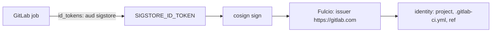

# GitLab CI Identities

GitLab CI can give a job an ID token for each run, in the same way GitHub Actions does. With the issuer `https://gitlab.com`, which the public-good Fulcio trusts, a pipeline can sign without a stored key. This part shows the pipeline file and the identity it produces. A lab cannot run GitLab, so the example is explained, not executed.

## Requesting the token

A job declares the token it needs with `id_tokens`. The `aud` value must match what Fulcio expects, which is `sigstore` for the public-good instance:

```yaml
sign-image:
  image:
    name: ghcr.io/sigstore/cosign/cosign:v3.1.4
    entrypoint: [""]
  id_tokens:
    SIGSTORE_ID_TOKEN:
      aud: sigstore
  script:
    - cosign sign --yes "$CI_REGISTRY_IMAGE@$IMAGE_DIGEST"
```

GitLab puts the token in the variable `SIGSTORE_ID_TOKEN`. cosign reads the token from that environment variable, so no `--identity-token` flag is needed. The job has no key, no password and no stored secret for signing. `IMAGE_DIGEST` here stands for the digest that an earlier job recorded.

## The identity it produces

The type of the issuer is `gitlab-pipeline`. Fulcio builds the subject from the pipeline configuration reference, and the identity looks like this:

```
https://gitlab.com/GROUP/PROJECT//.gitlab-ci.yml@refs/heads/main
```

The parts are the project path, the path of the pipeline file and the ref that ran. The issuer is `https://gitlab.com`. As with GitHub, the certificate also holds extensions for the pipeline: the project, the ref and the commit. A self-managed GitLab has its own issuer URL, and the public Fulcio does not trust it. For a self-managed GitLab you need a Fulcio that lists your instance.

## Verifying it

Pin the identity and the issuer, the same way as for GitHub Actions:

```sh
cosign verify \
  --certificate-oidc-issuer https://gitlab.com \
  --certificate-identity https://gitlab.com/GROUP/PROJECT//.gitlab-ci.yml@refs/heads/main \
  REGISTRY/IMAGE@sha256:DIGEST
```

Replace the group, project and image with your own. For tag releases use an anchored regular expression.



The diagram shows the path from a pipeline job to an identity, with no stored key in it.

## Common pitfalls

> [!WARNING]
> - **A wrong `aud`.** The token is refused if the audience is not the one Fulcio expects.
> - **Using the token in a job that runs merge request pipelines from forks.** Treat the ref in the identity as the thing you trust, and restrict releases to protected refs.
> - **Pinning only the project path.** The pipeline file and the ref are part of the identity. Pin the whole string.
