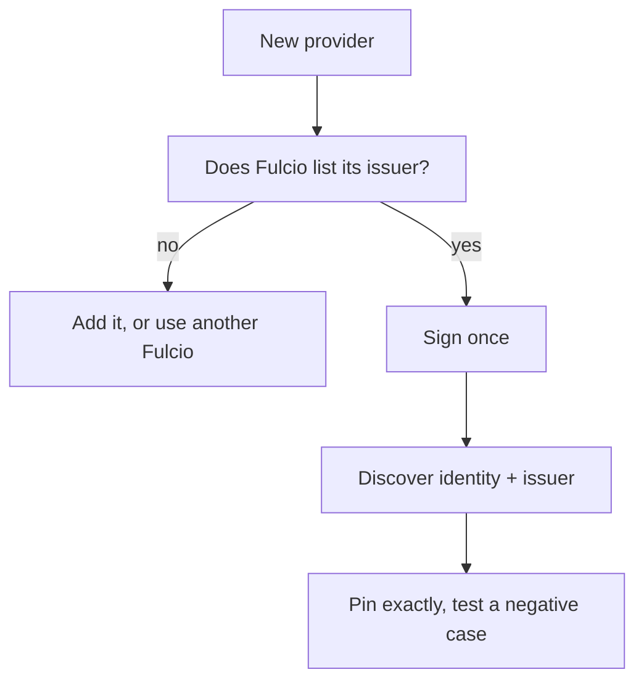

# Choosing The Flags For Each Provider

This part collects the verification values for the providers in this course and gives a procedure to follow when you meet a new one.

## The flags by provider

| Provider | Issuer to pin | Identity to pin |
| --- | --- | --- |
| GitHub Actions | `https://token.actions.githubusercontent.com` | `https://github.com/OWNER/REPO/.github/workflows/FILE@REF` |
| GitLab CI (gitlab.com) | `https://gitlab.com` | `https://gitlab.com/GROUP/PROJECT//.gitlab-ci.yml@REF` |
| Kubernetes service account | The cluster's service account issuer | `https://kubernetes.io/namespaces/NAMESPACE/serviceaccounts/NAME` |
| Interactive sign-in | The identity provider's issuer URL | The email address of the signer |

Every row is checked with `--certificate-identity` and `--certificate-oidc-issuer`, or with the `-regexp` forms when the ref varies. The GitHub-specific flags such as `--certificate-github-workflow-repository` add conditions on the certificate extensions.

## How the token reaches cosign

| Source | How |
| --- | --- |
| GitHub Actions | cosign requests the token itself when the job has `id-token: write` |
| GitLab CI | Variable `SIGSTORE_ID_TOKEN` from `id_tokens` |
| Kubernetes | A file from a projected token, passed with `--identity-token` |
| Any other | The environment variable `SIGSTORE_ID_TOKEN` or the flag `--identity-token` |

## A procedure for a new provider

1. Find the issuer URL and the audience the provider can set.
2. Check that your Fulcio lists the issuer, by reading its configuration.
3. Sign once in a test pipeline.
4. Discover the identity and issuer from the signature, from the signature itself.
5. Pin both exactly. Write the check, then try a signature from a different identity and see it fail.



The diagram shows the order: trust first, signing second, pinning last, then a negative test.

## Common pitfalls

> [!WARNING]
> - **Copying a flag set from one provider to another.** The identity format differs per type.
> - **Skipping the negative test.** A check you never saw fail may accept everything.
> - **Relying on defaults for the audience.** Set it explicitly in the pipeline.

## Your mission: Configure A Verifier For A Provider

You can now find and pin the values for a signer. The graded lab gives you a verifier configuration that fails for the real signer and asks you to repair it from the facts of the signature.

The lab runs in its own cluster, so first pause your playground. Nothing in it is lost:

```sh
astrona stop ats-120-playground-040-02
```

Then start the lab:

```sh
astrona run --git ssh://git@github.com/astrona-io/ATS120.git -c sections/section-040/module-02/labs/lab-01
```

The task is on the next page. Solve it on your own first. When you think you are done, send it for grading:

```sh
astrona submit -c sections/section-040/module-02/labs/lab-01
```

When the lab is done, remove it and start your playground again:

```sh
astrona destroy ats-120-lab-040-02
astrona start ats-120-playground-040-02
```
