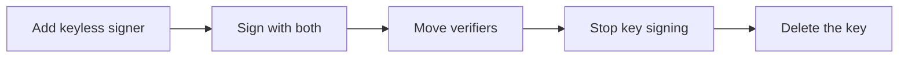

# Planning The Move From Keys To Keyless

A signing key is used in more places than the one that signs. Moving to keyless without a list of those places breaks a verifier that nobody remembered. This part makes the list and puts the changes in a safe order.

## Where a key hides

Search for these before you change anything:

| Place | What to look for |
| --- | --- |
| The signing job | `cosign sign --key`, a Secret with `cosign.key`, a password variable |
| The verifiers | `cosign verify --key`, a public key in a ConfigMap or in a repository |
| Admission policies | A policy that lists a public key as the authority |
| Documentation and scripts | Instructions that tell consumers which key to use |
| Backups and stores | Copies of the private key in vaults, laptops or old CI variables |

Each place is a task. The private key is the one that must disappear last, and its public key must stay accepted until every verifier has moved.

## A safe order

1. **Add the keyless signer.** Create the service account, the Job and the permissions. Do not remove anything.
2. **Sign with both.** Every release gets a key-based and a keyless signature.
3. **Move the verifiers.** Change each verifier, one at a time, from the public key to the pinned identity and issuer. Test each one with a keyless-only image.
4. **Stop signing with the key.** When the last verifier has moved, the pipeline signs keyless only.
5. **Remove the key.** Delete the Secret, the CI variable and the backups. Keep a record of the date.

The diagram shows the order. Deleting the key is the last step, not the first.

## What can go wrong in the order

- Removing the key before a verifier moves breaks that verifier at the next release.
- Moving a verifier before the keyless signature exists rejects every image.
- Leaving the key in place after the move keeps the risk the migration was meant to remove.

## Common pitfalls

> [!WARNING]
> - **Forgetting the admission policy.** It often lists a key and nobody owns it.
> - **Counting only CI.** Laptops and old scripts also hold the key.
> - **No date for removal.** A migration without a deadline leaves the key forever.
