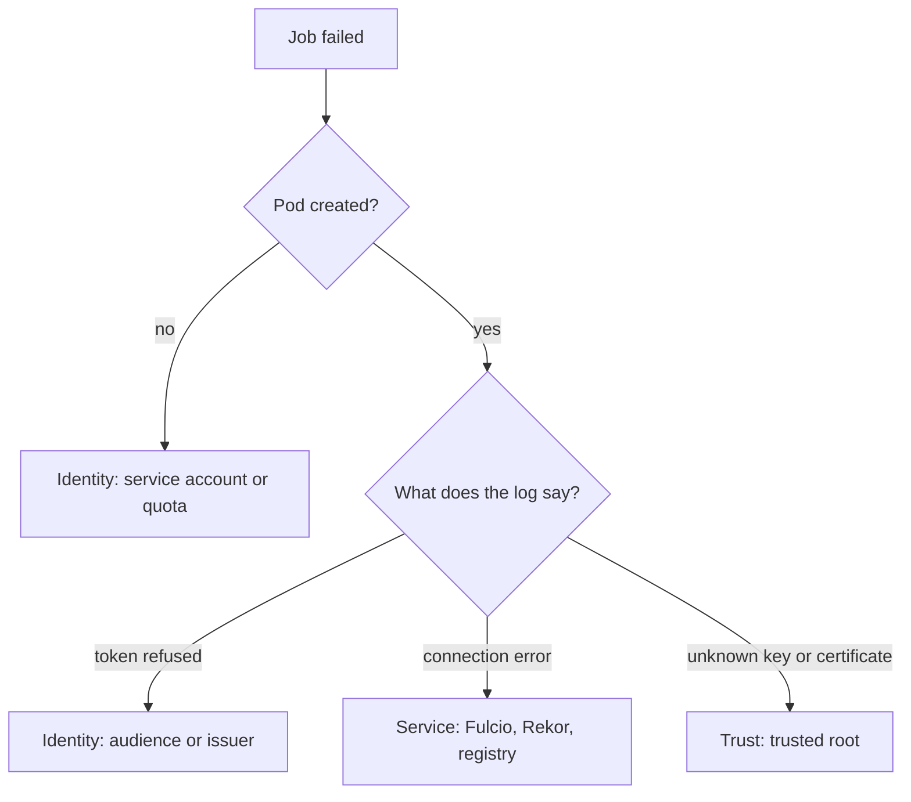

# Reading The Failures Of A Signing Job

A signing Job fails for a small number of reasons. Each has a place where the evidence is, and none of them is fixed by turning off a check. This part gives the places to look and the cause each one points to.

## Where to look first

<!-- astrona:playground:renew -->

For a Job named `sign-release` in the namespace `ci`:

```sh
kubectl -n ci describe job sign-release
kubectl -n ci get pods -l job-name=sign-release
kubectl -n ci logs job/sign-release
```

The first command shows the events of the Job. If no pod was created, the events say why. The second lists the pods. The third shows what cosign printed.

## Causes and their evidence

| Cause | Evidence |
| --- | --- |
| The service account does not exist | The Job has no pod. The events say that the service account was not found |
| The token has the wrong audience | The pod runs and fails. The cosign log shows that Fulcio refused the token |
| The token expired | The log shows an expired token. A token for a long-running step has to be refreshed or the step has to be shorter |
| The image reference does not exist | The pod fails when cosign reads the registry. The log shows a missing manifest |
| The registry needs credentials | The log shows an authorization error |
| Fulcio or Rekor cannot be reached | The log shows a connection error. Check the Services in `fulcio-system` and `rekor-system` |
| The trust files are out of date | The log shows a certificate or key that the trusted root does not know |

Read the log fully. The first error in it is the cause; later lines are results.

## Which side failed

Three groups of causes help to decide where to look:

- **Identity side:** the service account, the token and its audience. Fix the Job spec.
- **Service side:** Fulcio, Rekor, the registry. Check that the pods run and the Services answer.
- **Trust side:** the trusted root and the signing configuration. Update the ConfigMap.



The diagram shows the first question (was a pod created) and the three groups the answers lead to.

## What not to do

Do not add `--insecure-ignore-tlog`, `--insecure-ignore-sct` or `--allow-insecure-registry` to make a Job pass. They remove the proof that the signature relies on, and the Job then succeeds with a signature nobody can trust. If the registry in the playground is plain HTTP, the flag `--allow-http-registry` belongs to this lab setup only.

A Job spec cannot be edited after creation. Delete the Job and create it again with the fix.

## Common pitfalls

> [!WARNING]
> - **Reading only the last line of the log.** The first error carries the cause.
> - **Looking at the pod when there is none.** Read the Job's events.
> - **Retrying without a fix.** `backoffLimit: 0` makes the failure visible. A retry loop hides the cause.
